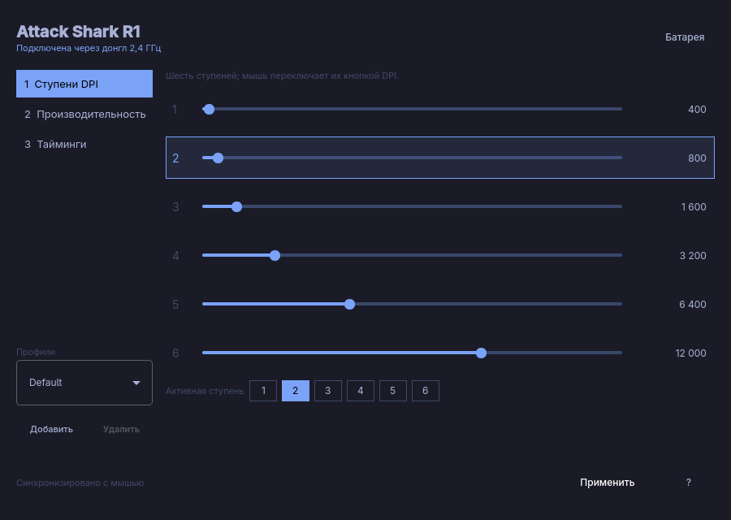

# shark

Configure an **Attack Shark R1** gaming mouse on Linux: the six DPI stages and
which one is active, the polling rate, ripple control, angle snap, sleep and
deep-sleep timers, click response time, and the battery level. One window, no
vendor installer, and the settings land in the mouse itself, so they keep
working on another computer.



## Install

```sh
bin/install          # builds and installs the shark package (needs libusb)
```

The package installs `/usr/bin/shark`, the launcher entry, the icon, and a udev
rule that hands the mouse's vendor interface to your user. **Replug the mouse
after the first install**, or the kernel keeps the interface and the app can
only say "no permission".

## Using it

| Key | Action |
| --- | --- |
| `Space` | Apply the profile to the mouse |
| `1` `2` `3` | DPI stages / performance / timing |
| `R` | Back to the factory defaults (then `Space` to send them) |
| `?` | Every shortcut, in one overlay |
| `Q` | Quit; if the mouse has not been updated yet it asks first |

The profile is saved to `~/.config/shark/profiles.json` as you change it. The
mouse gets it when you press Apply.

## From a terminal

Agents and scripts get the same settings without a display:

```sh
shark status --json            # profile, whether it differs from the mouse, device
shark apply --json             # send the active profile; exit 0 only on a real ack
shark battery --json           # {"percent": 100, "state": "discharging"}
shark set dpi0 800             # one setting; dpi0..dpi5, activeStage, pollingHz,
shark set sleepMin 4           # ripple, angleSnap, sleepMin, deepSleepMin, debounceMs
shark defaults --json          # factory defaults into the profile
shark profile Gaming           # switch the active profile
```

## How it talks to the mouse

`1d57:fa60` (dongle) and `1d57:fa61` (cable) are four HID interfaces; interface
2 is the vendor one, and its report descriptor declares feature reports
`0x04`, `0x05`, `0x06`. shark takes that interface with libusb, detaches the
kernel driver, and speaks the same framing the vendor software does:

- a configuration report is one `SET_REPORT` control transfer
  (`bmRequestType 0x21`, `wValue 0x0300 | report id`);
- the firmware answers with a 5-byte interrupt report on endpoint `0x83`,
  carrying `0x50` in byte 2 when it accepted the write;
- the same endpoint carries the battery: `03 10 40 01 0a` is *discharging,
  100 %*. The level is byte 4 × 10.

Writes over the dongle are occasionally lost, so every report is read back by
its ack and resent; the app fails loudly rather than pretending.

**The R1 cannot report its settings back.** There is no read command in the
firmware — the vendor software keeps its profiles in a file too. That is why
shark owns `profiles.json` and why the window says "In sync with the mouse"
only after an Apply that the mouse acknowledged.

Not implemented, because the firmware either does not expose it or it is not
confirmed on a real R1: per-button remapping, macro recording, lift-off
distance, motion sync, and lighting. The report layouts for those exist in the
vendor binary; anyone with captures from an R1 is welcome to extend
`src/r1.cpp`.

## Layout of the project

```text
shark.pro              qmake project
bin/build|test|install the usual three
src/r1.{h,cpp}         the protocol: report bytes, DPI codec, profile JSON
src/device.{h,cpp}     libusb: find, claim, write, wait for the ack, battery
src/backend.{h,cpp}    profiles on disk, state for QML, the --json CLI
src/Main.qml           the window, keyboard first
src/theme.*            follows the Omarchy accent, colors and window rounding
tests/                 the byte layouts, pinned offscreen
```

`shark shot <path> [width height]` renders the window offscreen and saves it,
which is how `screenshot.png` is made.

## Credits

The HID framing was worked out by others before me:
[xb-bx/attack-shark-r1-driver](https://github.com/xb-bx/attack-shark-r1-driver)
(DPI, timing and polling reports) and
[HarukaYamamoto0/attack-shark-x11-driver](https://github.com/HarukaYamamoto0/attack-shark-x11-driver)
(the read/ack handshake for this dongle family). The theme, translator and
build layout follow Omarchy's own apps (Omacut, Monologue, MIT, David
Heinemeier Hansson).

MIT licensed.
